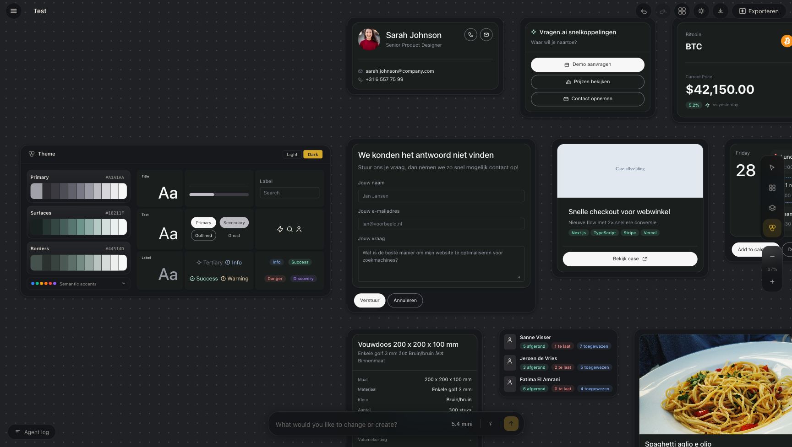

# GenUI Studio

[](https://www.npmjs.com/package/@swis/genui-studio)
[](LICENSE)
[](https://plant.treeware.earth/swisnl/genui-studio)
[](https://www.swis.nl)

An AI-powered visual UI widget builder and design studio. Create, edit, and manage reusable widget templates with the help of Claude or ChatGPT.



## What it does

GenUI Studio is a web-based IDE for building OpenAI Chatkit compatible widgets. You describe what you want in natural language, and the AI agent generates or modifies widget templates on a visual canvas. Templates use a JSX-like syntax that compiles to Nunjucks JSON templates, compatible with the [`@swis/genui-widgets`](https://github.com/swisnl/genui-widgets) component library.

Key features:
- **AI agent** — Chat with Claude or ChatGPT to generate and modify widgets
- **Visual canvas** — Drag, position, and arrange widgets on an infinite canvas
- **Live preview** — See widgets render with dynamic template data in real time
- **Theme system** — Full light/dark mode with customizable color palettes
- **Multi-project** — Create and switch between multiple projects
- **Multilingual** — English and Dutch interface
- **Undo/redo** — Full history with keyboard shortcuts

## Quick start

Run it instantly with npx. No clone or install required:

```bash
npx @swis/genui-studio
```

Then open [http://localhost:4277](http://localhost:4277) in your browser.

You can change the port with the `PORT` environment variable:

```bash
PORT=3000 npx @swis/genui-studio
```

## Requirements

- Node.js 18+
- An [Anthropic API key](https://console.anthropic.com/) and/or [OpenAI API key](https://platform.openai.com/)

API keys can be entered directly in the app's prompt bar.

## WebMCP tools

In browsers with [WebMCP](https://developer.chrome.com/docs/ai/webmcp/imperative-api), the studio registers tools that let any agent build widgets on the board:

| Tool | Purpose |
|---|---|
| `generate_widget` | Design a widget from a prompt with the studio's own agent. Pass `data` to build it around real values, `widgetId` to change an existing one |
| `list_widgets`, `get_widget` | Read the board |
| `set_widget_data` | Replace a widget's data without redesigning it |
| `delete_widget` | Remove a widget |
| `get_authoring_guide`, `create_widget`, `update_widget` | Write widget JSX yourself, with validation errors returned for retries |

Every tool returns JSON: `{ "ok": true, ... }` or `{ "ok": false, "error": { "code", "message" } }`.

When the studio is embedded (`?embed=1&parentOrigin=...`), its tools are exposed to the host page. Grant the iframe the `tools` permission and read them with `fromOrigins`:

```html
<iframe src="https://studio.example.com/?embed=1&parentOrigin=https://host.example.com" allow="tools"></iframe>
```

```js
import { getStudioTools, onStudioToolsChange } from '@swis/genui-studio/embed'

const tools = await getStudioTools('https://studio.example.com')
// Hand these to your agent, or run one directly:
const generate = tools.find((t) => t.name === 'generate_widget')
await document.modelContext.executeTool(generate, { prompt: 'An employee card', data: { name: 'Grace Hopper' } })
```

New and changed widgets reach the host through the embed client's `onChange`, as with manual edits. `generate_widget` uses the LLM provider configured in the embed config.

## Development

If you want to contribute or run from source:

```bash
git clone https://github.com/swisnl/genui-studio.git
cd genui-studio
npm install
```

```bash
# Development server (hot reload)
npm run dev

# Build for production
npm run build

# Preview production build
npm run preview
```

## Changelog

Please see [CHANGELOG](CHANGELOG.md) for more information on what has changed recently.

## Contributing

Please see [CONTRIBUTING](https://github.com/spatie/.github/blob/main/CONTRIBUTING.md) for details.

## Security Vulnerabilities

Please review [our security policy](../../security/policy) on how to report security vulnerabilities.

## Credits

- [Joris Meijer](https://github.com/jormeijer)
- [All Contributors](../../contributors)

## License

This package is open-sourced software licensed under the [GPL License](LICENSE).

This package is [Treeware](https://treeware.earth). If you use it in production, then we ask that you [**buy the world a tree**](https://plant.treeware.earth/swisnl/genui-studio) to thank us for our work. By contributing to the Treeware forest you'll be creating employment for local families and restoring wildlife habitats.

## SWIS :heart: Open Source

[SWIS](https://www.swis.nl) is a web agency from Leiden, the Netherlands. We love working with open source software.
